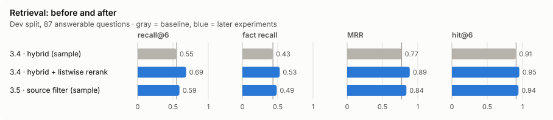

# Results

> Generated by `uv run main.py eval report` from the labelled runs in Postgres. Don't edit by hand.
> **Baseline** = the first labelled run of each kind; **Δ** = change against it.
> Label a run with `uv run main.py eval label <run-id> "<label>"`.

## Retrieval

### All answerable dev questions: 451 questions

| Experiment | recall@6 | Δ | fact recall | Δ | MRR | Δ | hit@6 | Δ | context tokens | run | commit |
|---|--:|--:|--:|--:|--:|--:|--:|--:|--:|---|---|
| M2 · dense (baseline) | 0.56 | — | 0.44 | — | 0.73 | — | 0.89 | — | — | `retrieval-dense-20261108-234016` | `085a59e` |
| 3.1 · keyword only | 0.48 | −0.08 | 0.35 | −0.09 | 0.58 | −0.15 | 0.80 | −0.09 | — | `retrieval-keyword-20261111-173317` | `1bff4d0` |
| 3.1 · hybrid (RRF) | 0.61 | +0.04 | 0.48 | +0.04 | 0.76 | +0.02 | 0.91 | +0.02 | 2,865 | `retrieval-hybrid-20261111-180947` | `229c7a1` |
| 3.2 · semantic chunks (hybrid) | 0.61 | +0.05 | 0.47 | +0.03 | 0.78 | +0.05 | 0.92 | +0.03 | 2,668 | `retrieval-hybrid-20261111-181156` | `229c7a1` |
| 3.2 · recursive chunks (hybrid) | 0.61 | +0.05 | 0.47 | +0.04 | 0.77 | +0.04 | 0.92 | +0.03 | 2,791 | `retrieval-hybrid-20261111-181414` | `229c7a1` |
| 3.3 · query rewrite (hybrid) | 0.57 | 0.00 | 0.44 | 0.00 | 0.71 | −0.02 | 0.88 | −0.01 | 2,856 | `retrieval-hybrid-rewrite-20261111-182907` | `72dd224` |
| 3.3 · multi-query ×3 (hybrid) | 0.57 | +0.01 | 0.43 | −0.01 | 0.70 | −0.03 | 0.89 | 0.00 | 2,866 | `retrieval-hybrid-multi_query-20261111-185440` | `72dd224` |
| 3.3 · HyDE (hybrid) | 0.61 | +0.05 | 0.49 | +0.05 | 0.76 | +0.03 | 0.92 | +0.02 | 2,823 | `retrieval-hybrid-hyde-20261111-193439` | `72dd224` |
| 3.5 · source filter (hybrid) | 0.66 | +0.10 | 0.55 | +0.11 | 0.83 | +0.09 | 0.96 | +0.07 | 2,853 | `retrieval-hybrid-source-20261113-094137` | `21d29b4` |
| 3.6 · compression keep 0.5 (hybrid) | 0.61 | +0.04 | 0.45 | +0.01 | 0.76 | +0.02 | 0.91 | +0.02 | 1,810 | `retrieval-hybrid-embedding-20261113-095517` | `9ccd429` |
| 3.6 · compression keep 0.7 (hybrid) | 0.61 | +0.04 | 0.47 | +0.03 | 0.76 | +0.02 | 0.91 | +0.02 | 2,360 | `retrieval-hybrid-embedding-20261113-100818` | `9ccd429` |

*Context tokens* = average tokens in the top 6 chunks, i.e. what the LLM reads. Compare chunkers at a similar budget: more text can raise recall without better chunking.

**recall@6 by question type**

| Experiment | comparison | inference | temporal |
|---|--:|--:|--:|
| M2 · dense (baseline) | 0.62 | 0.44 | 0.65 |
| 3.1 · keyword only | 0.53 | 0.37 | 0.56 |
| 3.1 · hybrid (RRF) | 0.70 | 0.47 | 0.66 |
| 3.2 · semantic chunks (hybrid) | 0.69 | 0.49 | 0.67 |
| 3.2 · recursive chunks (hybrid) | 0.69 | 0.49 | 0.65 |
| 3.3 · query rewrite (hybrid) | 0.67 | 0.41 | 0.64 |
| 3.3 · multi-query ×3 (hybrid) | 0.67 | 0.46 | 0.60 |
| 3.3 · HyDE (hybrid) | 0.69 | 0.50 | 0.65 |
| 3.5 · source filter (hybrid) | 0.76 | 0.50 | 0.73 |
| 3.6 · compression keep 0.5 (hybrid) | 0.70 | 0.47 | 0.66 |
| 3.6 · compression keep 0.7 (hybrid) | 0.70 | 0.47 | 0.66 |

### Sample (for slow experiments): 87 questions

| Experiment | recall@6 | Δ | fact recall | Δ | MRR | Δ | hit@6 | Δ | context tokens | run | commit |
|---|--:|--:|--:|--:|--:|--:|--:|--:|--:|---|---|
| 3.4 · hybrid (sample) | 0.55 | — | 0.43 | — | 0.77 | — | 0.91 | — | 2,862 | `retrieval-hybrid-20261113-081133` | `cb27a64` |
| 3.4 · hybrid + listwise rerank | 0.69 | +0.13 | 0.53 | +0.10 | 0.89 | +0.11 | 0.95 | +0.05 | 2,817 | `retrieval-hybrid-listwise-20261113-081204` | `cb27a64` |
| 3.5 · source filter (sample) | 0.59 | +0.04 | 0.49 | +0.05 | 0.84 | +0.07 | 0.94 | +0.03 | 2,852 | `retrieval-hybrid-source-20261113-094234` | `21d29b4` |

*Context tokens* = average tokens in the top 6 chunks, i.e. what the LLM reads. Compare chunkers at a similar budget: more text can raise recall without better chunking.

**recall@6 by question type**

| Experiment | comparison | inference | temporal |
|---|--:|--:|--:|
| 3.4 · hybrid (sample) | 0.65 | 0.41 | 0.65 |
| 3.4 · hybrid + listwise rerank | 0.75 | 0.58 | 0.76 |
| 3.5 · source filter (sample) | 0.76 | 0.42 | 0.65 |

## Answers

| Experiment | n | accuracy | Δ | exact match | refusal rate | cited | model · prompt | run | commit |
|---|--:|--:|--:|--:|--:|--:|---|---|---|
| M2 · no retrieval (baseline) | 100 | 0.42 | — | 0.39 | 0.65 | 0.00 | gemma4:12b · closed_book@1 | `answers-closed_book-20261108-234114` | `085a59e` |
| M2 · RAG, dense search | 100 | 0.53 | +0.11 | 0.17 | 0.46 | 0.54 | gemma4:12b · answer@1 | `answers-rag-20261108-234555` | `085a59e` |

`*` after a commit = the run started with uncommitted changes.
