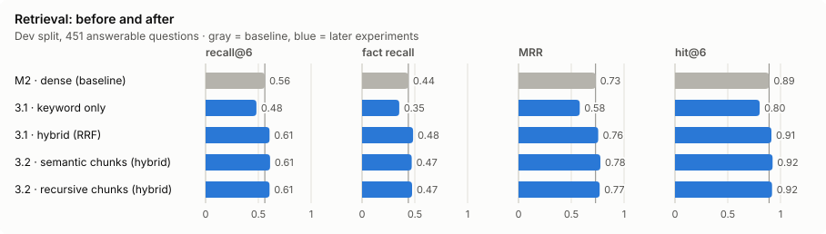
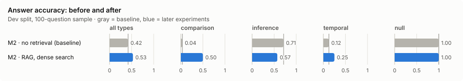

# Results

> Generated by `uv run main.py eval report` from the labelled runs in Postgres. Don't edit by hand.
> **Baseline** = the first labelled run of each kind; **Δ** = change against it.
> Label a run with `uv run main.py eval label <run-id> "<label>"`.

## Retrieval

| Experiment | recall@6 | Δ | fact recall | Δ | MRR | Δ | hit@6 | Δ | run | commit |
|---|--:|--:|--:|--:|--:|--:|--:|--:|---|---|
| M2 · dense (baseline) | 0.56 | — | 0.44 | — | 0.73 | — | 0.89 | — | `retrieval-dense-20261108-234016` | `085a59e` |
| 3.1 · keyword only | 0.48 | −0.08 | 0.35 | −0.09 | 0.58 | −0.15 | 0.80 | −0.09 | `retrieval-keyword-20261111-173317` | `1bff4d0` |
| 3.1 · hybrid (RRF) | 0.61 | +0.04 | 0.48 | +0.04 | 0.76 | +0.02 | 0.91 | +0.02 | `retrieval-hybrid-20261111-173451` | `1bff4d0` |

**recall@6 by question type**

| Experiment | comparison | inference | temporal |
|---|--:|--:|--:|
| M2 · dense (baseline) | 0.62 | 0.44 | 0.65 |
| 3.1 · keyword only | 0.53 | 0.37 | 0.56 |
| 3.1 · hybrid (RRF) | 0.70 | 0.47 | 0.66 |

## Answers

| Experiment | n | accuracy | Δ | exact match | refusal rate | cited | model · prompt | run | commit |
|---|--:|--:|--:|--:|--:|--:|---|---|---|
| M2 · no retrieval (baseline) | 100 | 0.42 | — | 0.39 | 0.65 | 0.00 | gemma4:12b · closed_book@1 | `answers-closed_book-20261108-234114` | `085a59e` |
| M2 · RAG, dense search | 100 | 0.53 | +0.11 | 0.17 | 0.46 | 0.54 | gemma4:12b · answer@1 | `answers-rag-20261108-234555` | `085a59e` |

`*` after a commit = the run started with uncommitted changes.
