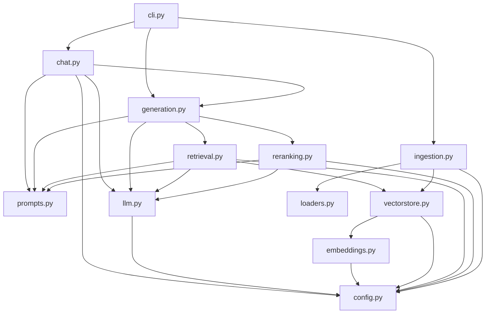
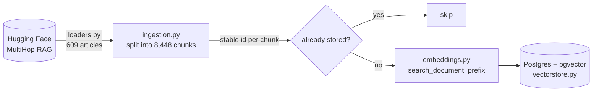
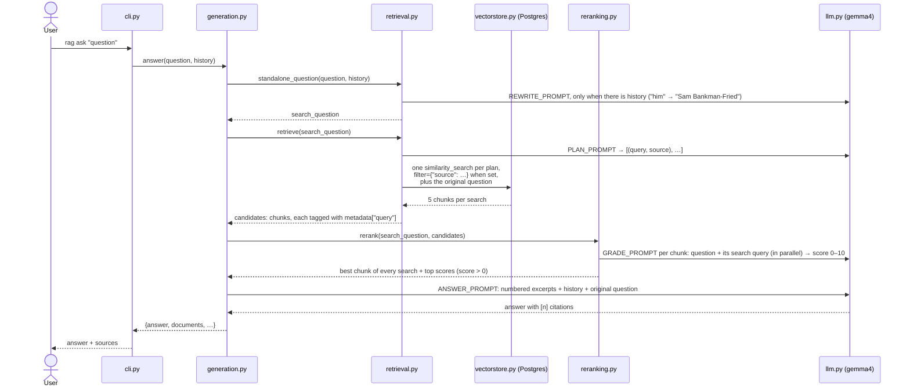
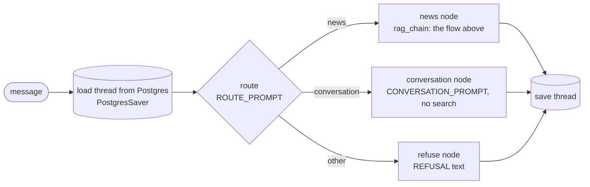

# rag_langchain

A production-style RAG pipeline over the MultiHop-RAG news corpus. It uses only the preferred pieces from
[`LADDER.md`](../../LADDER.md); the step-by-step versions are in [`walkthrough/`](../../walkthrough/).

```bash
uv run rag ingest              # load, split, embed and store the corpus (skips stored chunks)
uv run rag ask "question"      # answer one question, with sources
uv run rag chat                # a saved conversation: routes each message, prints its thread id
uv run rag chat --thread ID    # continue a saved conversation
```

## Modules

The names follow the RAG stages in order: loaders → ingestion → vectorstore → retrieval → reranking → generation.

| Module | Job | Walkthrough steps |
|---|---|---|
| [`cli.py`](cli.py) | The `rag` command: parses arguments, prints answers, runs the chat loop | — |
| [`chat.py`](chat.py) | A LangGraph graph: route each message (news / conversation / other), answer it, save the conversation in Postgres per thread | 21b, 22 |
| [`config.py`](config.py) | Settings from environment variables (`RAG_DATABASE_URL`, `RAG_CHAT_MODEL`, …) | — |
| [`llm.py`](llm.py) | The chat model (gemma4 via Ollama) | 1 |
| [`embeddings.py`](embeddings.py) | nomic-embed-text with its `search_document:` / `search_query:` prefixes | 8, 9 |
| [`prompts.py`](prompts.py) | Every prompt: rewrite, plan, grade, answer, route, conversation, plus the refusal text | 2, 13, 17–20, 22 |
| [`loaders.py`](loaders.py) | The dataset as LangChain Documents | 6 |
| [`vectorstore.py`](vectorstore.py) | The Postgres vector store, and the list of publication names | 10 |
| [`ingestion.py`](ingestion.py) | Load → split → embed only the chunks not stored yet | 7, 10 |
| [`retrieval.py`](retrieval.py) | Rewrite follow-ups with the history; plan (query, publication) searches → filtered vector search → dedupe | 16, 18, 20 |
| [`reranking.py`](reranking.py) | The LLM scores each candidate 0–10, seeing the full question and the search that found it; keep the best of every search, then the top scores up to 5 | 17 |
| [`generation.py`](generation.py) | The full chain: rewrite → retrieve → rerank → answer with citations and history | 12, 13, 19, 20 |

## Who imports whom

Imports only point downwards, and no module does any work when imported: models and connections are
created on first use (`@cache`).



## `rag ingest`: from the dataset to Postgres



## `rag ask`: from a question to an answer



## `rag chat`: routing and saved conversations



The graph's state is `{"messages", "documents"}`: `messages` grows every turn (that's the history),
`documents` holds the latest answer's sources. The checkpointer saves it after every step under the
`thread_id`, so `rag chat --thread ID` continues where it stopped, even after a restart.

To look inside a thread: `graph.get_state(config).values` (what's saved) and
`graph.get_state_history(config)` (every checkpoint, newest first).

## The data that flows through `generation.py`

`rag_chain()` is one LCEL chain; each `.assign` adds a key to the same dict (ladder rung 4):

| After | Dict keys |
|---|---|
| input | `question`, `history` |
| `.assign(search_question=…)` | + `search_question`: the question rewritten to stand alone (the same question on the first turn) |
| `.assign(candidates=…)` | + `candidates`: chunks from every search, deduplicated, each with `metadata["query"]` = the search that found it (often 10–25 chunks) |
| `.assign(documents=…)` | + `documents`: the best chunk of every search, then the highest scores up to 5 |
| `.assign(context=…)` | + `context`: the documents as numbered text |
| `.assign(answer=…)` | + `answer`: the LLM's reply with `[n]` citations |

## Known limits

- Slow: one LLM call to rewrite a follow-up, one to plan, one per candidate to rerank, one to answer (about 2–3 minutes per question
  on an M1 Pro).
- Questions about the conversation itself ("what was my first question?") still trigger a search; deciding
  whether to search at all is routing (walkthrough step 22).
- `rag ask` isn't routed: an off-topic question still searches and answers "Insufficient information."
- The router can pick the wrong route, silently; it's an extra LLM call per message, and not real security.
- Saved threads are never trimmed or deleted, and the whole history is sent with every message.
